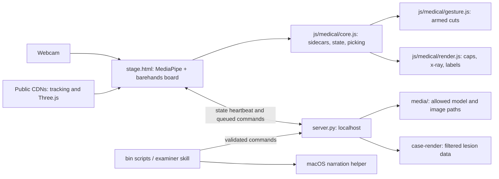
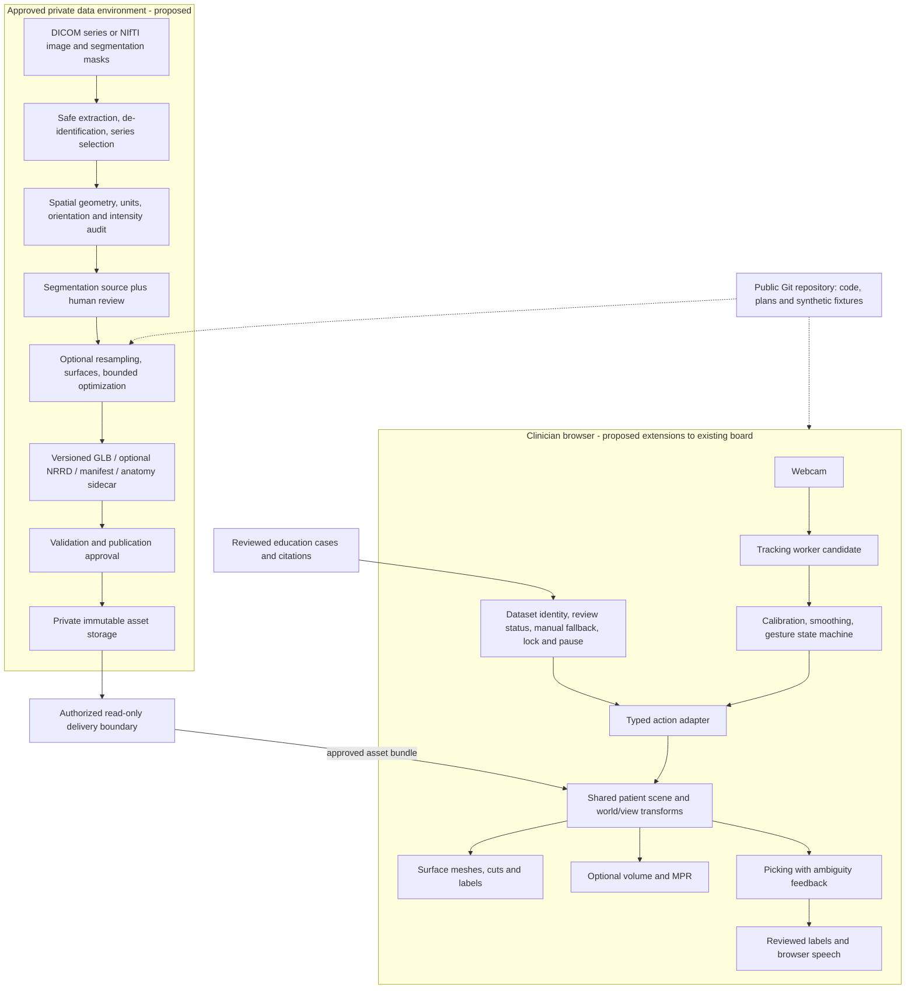
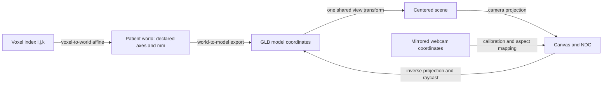
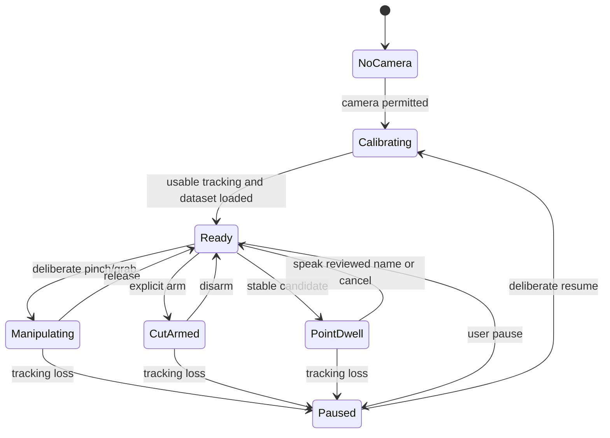

# System architecture and design schematic

Status: planning design, 2026-11-02. **Existing** means inspected source;
**proposed** means a target interface or component, not deployed code. Task IDs
refer to the [project plan](../project/plan.md). Keep changes to this design in
the same PR as the implementation or in a linked ADR.

## Existing runtime

There is no patient-scan ingestion pipeline, volume renderer, React application,
FastAPI service, persistent patient database, or browser TTS implementation in
this baseline. A generic 16-structure heart is not a patient reconstruction.
The examiner is an agent workflow; it is not yet a complete browser case UI.

## Proposed end-to-end system

The private asset boundary is a target. Existing `server.py` is a localhost
development server, not an authenticated clinical service. Patient bundles must
not be committed to this public repository or placed under its publicly served
paths. Early integration uses synthetic or approved de-identified fixtures.
Resolve private delivery with G1/G4 before enabling patient-data workflows.

## Component ownership and contracts

| Boundary | Contract and failure behavior | Tasks |
| --- | --- | --- |
| Scan -> canonical image | Chosen series, dimensions, voxel-to-world affine, units, orientation, intensity scale, source hashes; reject mixed/ambiguous geometry. | 1.1-1.3 |
| Image/mask -> surfaces | Reviewed categorical segmentation, common grid, stable labels; preserve structure identity and report missing structures rather than inventing them. | 1.4-1.5, 1.8 |
| Build -> asset bundle | Immutable revision and schema version; hashes, coordinate chain and QA report; incomplete/rejected bundles cannot be silently published. | 1.6, 1.9 |
| Bundle -> scene | Validate supported schema, matching assets/sidecars, transforms and limits before replacing the active scene; show load failure and retain a clear prior-state indicator. | 2.3-2.4 |
| Tracking -> actions | Handedness, timestamp, confidence, normalized coordinates and gesture lifecycle; tracking loss freezes manipulation and clears selection/speech. | 3.2-3.8, G3 |
| Picking -> label/speech | Dataset revision + stable structure ID + hit point; dwell and confidence gates; no-hit/ambiguous state produces no guessed anatomy. | 2.7, 3.8, 3.10 |
| Case -> educational view | Preserve current `/case-render` answer isolation and verified-case rules. Patient annotations use a separate schema/mode from teaching answers. | 3.9 |

Proposed action adapter: `begin`, `update`, `end`, `cancel` for manipulation;
`armCut`, `setCutPlane`, `setSelection`, `clearSelection`, `pause`, `reset` for
explicit actions. Resolve naming/schema through the contract PR. It adapts into
existing validated verbs; it does not authorize a generic command passthrough.

## Physical geometry and display transforms

Use these implementation requirements for G2 and tasks 1.1-2.7:

- Derive DICOM slice order from image position projected onto the slice normal
  obtained from image orientation; check spacing/consistency and selected series.
  InstanceNumber and SliceLocation alone are insufficient geometric authority.
- Preserve NIfTI affine/header metadata and explicitly resolve disagreeing
  qform/sform entries. DICOM patient axes and NiBabel RAS+ need an explicit
  conversion; do not use an unlabeled axis flip.
- Validate source image and mask alignment before processing. Use categorical
  interpolation for labels and documented intensity interpolation for images.
  Optional resampling updates the affine and records the original grid.
- Extract surfaces with physical spacing/affines. Center and scale the entire
  bundle with one transform, never each structure independently. Keep the inverse
  transform for positions and future measurements in millimeters.
- The existing heart sidecar declares its own axes; it is not proof that future
  GLB exports share those axes. Test a synthetic asymmetric phantom and known
  distances to detect mirroring, origin drift and scaling errors.
- Do not treat GLB clipping as a density slice. MPR samples image voxels; a surface
  cut/cap shows the boundary model. Both must agree in a common patient frame.
- Perspective webcam hand depth controls UI actions; it does not measure anatomy
  or register the display to a physical patient.

These are engineering design decisions based on the
[DICOM Image Plane Module](https://dicom.nema.org/medical/dicom/current/output/chtml/part03/sect_C.7.6.2.html)
and [NiBabel coordinate documentation](https://nipy.org/nibabel/coordinate_systems.html).
Numerical tolerances must be agreed with imaging reviewers before acceptance.

## Proposed asset manifest

Introduce a separately versioned bundle manifest; do not silently change
`barehands-anatomy/1` or `barehands-case/1`. The first implementation should
define machine-validatable schemas and synthetic valid/invalid fixtures for:

| Field group | Required intent |
| --- | --- |
| Identity | Schema version, opaque bundle ID, immutable revision, source series pseudonym; no patient name in identifiers or logs. |
| Geometry | Units, named axes, shape/spacing, voxel-to-world affine, world-to-model transform, optional resampling transform and handedness. |
| Assets | Relative paths, media types, byte size, hashes, original and optimized mesh versions, volume availability. |
| Structure mapping | Stable structure IDs mapped to GLB mesh names, label values, anatomy sidecar and reviewed annotations. |
| Provenance | Dataset/source license, conversion tool versions/configuration, segmentation method and reviewer status, timestamp. |
| Validation | Geometry comparison metrics, mask/mesh checks, warning/error findings and review state. |

No automatic segmentation model is selected by this plan. A surface-extraction
pipeline requires segmentation masks; marching cubes does not identify organs
from raw intensities by itself. Liver, tumor and vessel labels must actually
exist in the chosen source or be separately produced and reviewed. Do not combine
unrelated patients or datasets into one claimed patient organ model.

## Interaction and clinician-facing design

This state diagram is proposed behavior, not an exact description of current
gesture code. Distinguish gesture tracking confidence from segmentation review
status and dataset freshness. Provide one active interaction mode, a visible
armed/locked indicator, reset, mute/repeat and mouse/keyboard fallback. Surface
labels and speech use reviewed sidecar text, never runtime medical invention.

The educational case panel must keep examiner-only answers out of learner views.
A patient-review panel instead shows active dataset/series/revision, orientation,
review state, annotation provenance and source-image comparison. Clinical identity
confirmation belongs inside the authorized private workflow, not public Git.

## Interaction contract as built (3.4–3.6, verified 2026-11-04)

This section describes the **existing** stage.html / core.js behaviour as
`tests/test_pinch_point.mjs` measures it. It is not the proposed state machine
above. It is the baseline the proposed action adapter has to map onto. The
numbers are the code's current constants, not tuned recommendations.
[Findings](../validation/2026-11-04-3-4-3-6-gestures.md).

| Input | Rule (current code) | Output to the board |
| --- | --- | --- |
| Cursor position | Midpoint of the thumb tip (4) and index tip (8), mirrored to screen px, EMA 0.45 per frame. **(3.5-1, fixed)** Cursor identity is MediaPipe handedness (Left = 0, Right = 1), falling back to list order if the labels collide. | `cur.x/y` |
| Pinch enter | gap/span < 0.32 (frontal) or < 0.38 (palm aspect < 2), **and** a signature: contrast law (back-finger arch − index arch > 0.18 and back arch > 1.30) or the profile rule (thumb–ring-knuckle > 0.95 span). The signature must hold 2 consecutive frames or an EMA > 0.55; a hand already holding something is exempt. Span = wrist→middle knuckle, so the rule is hand-size and distance invariant. | `cur.pinched` |
| Pinch hold / release | Hysteresis: release at gap/span ≥ 0.55. A fast hand (> 800 px/s) needs ≥ 0.70 on 2 frames running. Probation: a fresh pinch that loses its signature for 4 frames inside 400 ms is dropped. A palm aspect > 6 (impossible hand) drops immediately. | grab begins/ends |
| Move | One pinching hand carries the item at a fixed offset | `x, y` |
| Rotate | Holding still for 1 s (drift ≤ 45 px) latches rotate. Yaw = start + Δx·0.012 rad/px (free for models, ±1.2 for panes); pitch = start + Δy·0.012, clamped ±1.2. Release keeps yaw momentum. | `rx, ry`, `rvy` |
| Scale | Two hands pinching one item: scale = s0·d/d0, clamped 0.12–12×, centred between the hands. No two-hand roll. | `scale` |
| Point | An open (unpinched) hand held still (≤ 26 px) for 600 ms, then the same structure for 600 ms, is published. Hidden or cut-away hits and unlisted meshes are skipped. A pinch clears it. **(3.5-2, fixed)** Two resting hands on different structures publish `{ambiguous, candidates}` with no `structure`. | `/state.pt` |
| Reset / fallback | Keyboard: R respawns the board, C cycles the camera, D shows debug, X arms the cut. **(3.6-1, fixed)** Mouse on a model: drag = move, Shift/right-drag = rotate (0.012 rad/px, pitch ±1.2), wheel = scale (0.12–12×), double-click = reset pose. A model held by a hand ignores the mouse. | `x, y, rx, ry, scale` |
| Tracking loss | **(G3-1, fixed)** A missing hand is frozen, shown as a dimmed grey cursor, for 500 ms. If it returns it resumes; if not, it is dropped with no fling and no tap. **(G3-2, fixed)** `pt` is cleared about 400 ms after the last hand leaves. | — |

Gaps found on 2026-11-04 and fixed on 2026-11-05 in `js/medical/interaction.js`
and `core.js`: G3-1, G3-2, 3.5-1, 3.5-2, 3.6-1. Still open: 3.4-1 (a sideways
fist passed the profile rule in synthetic geometry only). The webcam session in
[the Phase 2 webcam protocol](../validation/phase2-webcam-session.md) decides it.

## Delivery, performance and open decisions

- Preserve the current Python/vanilla-JS runtime until an ADR supports a change.
  Worker tracking, React/Vite, FastAPI and a volume library are candidates.
- Keep the media airlock and validated verbs. Any ingestion service is isolated
  from board commands and cannot publish an arbitrary local path into the viewer.
- Pin and provision browser dependencies for reproducible/offline evaluation.
  Inspect browser speech voice/network behavior; offline TTS is not guaranteed.
- Choose reference hardware and budgets at M0 for frame time, input latency,
  memory, bundle load time/size and geometry error. Record measurements, not
  unmeasured performance claims. Surface-only fallback should be explicit.
- Neither this schematic nor a successful render establishes preoperative or
  intraoperative readiness. Those releases need the evidence in the
  [validation strategy](../validation/strategy.md).

## Proposed code placement

Existing paths keep their current purpose. Create proposed paths only when their
implementation task starts:

| Path | State / responsibility |
| --- | --- |
| `stage.html`, `js/medical/` | Existing board and medical rendering/interaction; marked optional medical hooks preserve upstream integration. |
| `server.py`, `schemas/` | Existing local interface and contracts; add versioned bundle schema alongside current schemas. |
| `pipeline/` | Proposed offline/operator ingestion and export modules. |
| `tests/fixtures/` | Proposed small synthetic fixtures and expected geometry; no patient identifiers. |
| `data/`, `artifacts/` | Ignored local research work areas, never a clinical storage/security control. |
| External private storage | Required target for patient inputs and derived patient bundles; access, retention and publishing design still to be agreed. |
| `docs/decisions/`, `docs/validation/` | Committed ADRs and non-sensitive evidence summaries linked to immutable revisions. |
