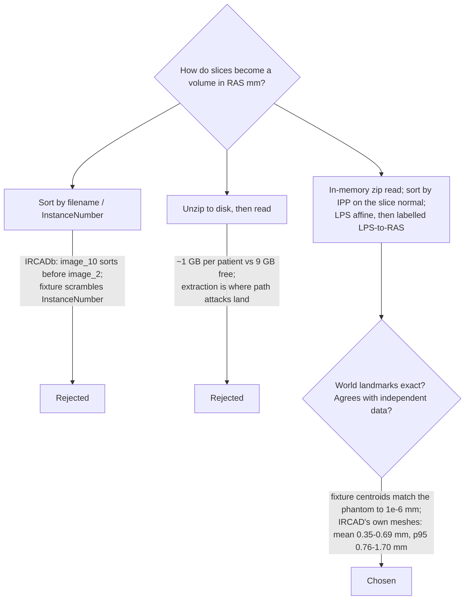
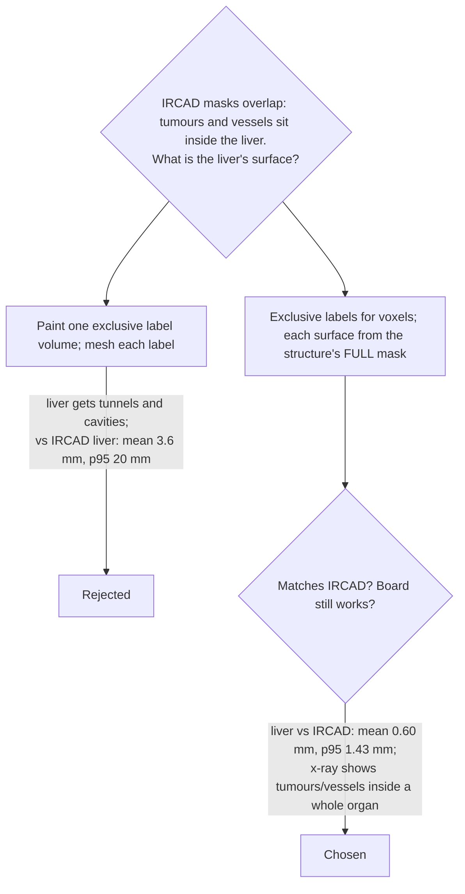
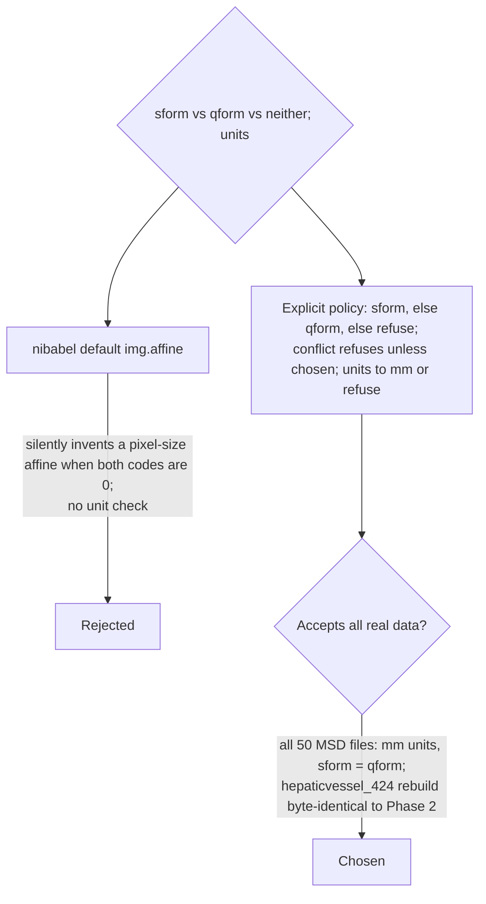
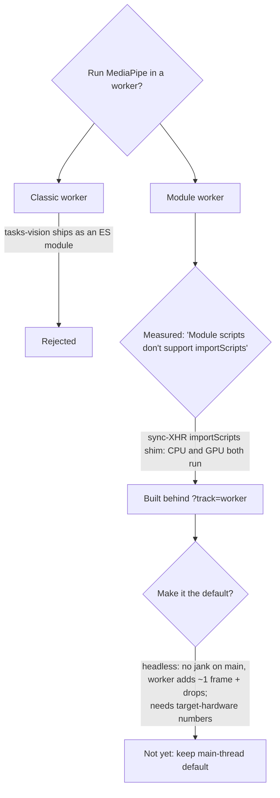
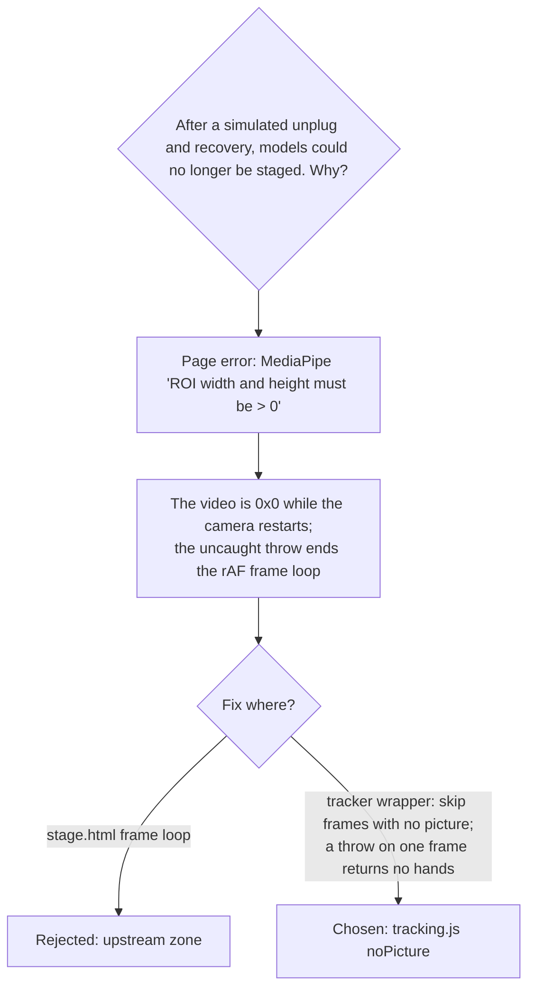
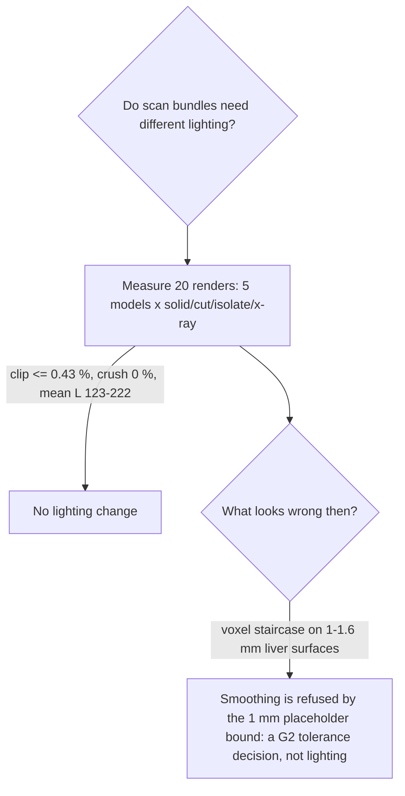

# Phase 1 decision log (decision trees)

Same format as the [Phase 2 log](phase2-decision-log.md): question → options →
criterion → chosen leaf, with evidence. Status stays `proposed` until the
owners' review accepts it.

## D-P1-01 Reading DICOM: order, frame and archives

2026-11-05 · tasks 1.1, G1, G2 · proposed

## D-P1-02 Overlapping structures: carve or keep whole?

2026-11-05 · tasks 1.1, 1.4 · proposed

MSD has no overlapping masks (the labels are exclusive by definition), so `msd-liver`'s
liver surface is built from `labels in {liver, tumour}`. This changes the
`liver_39` bundle compared with Phase 2. The change is intended.

## D-P1-03 Which NIfTI header affine to trust

2026-11-05 · task 1.2 · proposed

## D-P1-04 Tracking in a worker: how, and default?

2026-11-05 · tasks 3.2, G5 · proposed · ADR [0005](0005-tracking-worker.md)

## D-P1-05 A camera restart froze the board

2026-11-05 · tasks 3.3, G3 · proposed

The browser suite now stages a model **after** an unplug/recovery, which is what
caught this. The C-key camera switch opens the same 0×0 window. That's plausible
but not reproduced here (a single fake camera).

## D-P1-06 Lighting (2.2): change it?

2026-11-05 · task 2.2 · proposed, **pending your review of the contact sheet**

