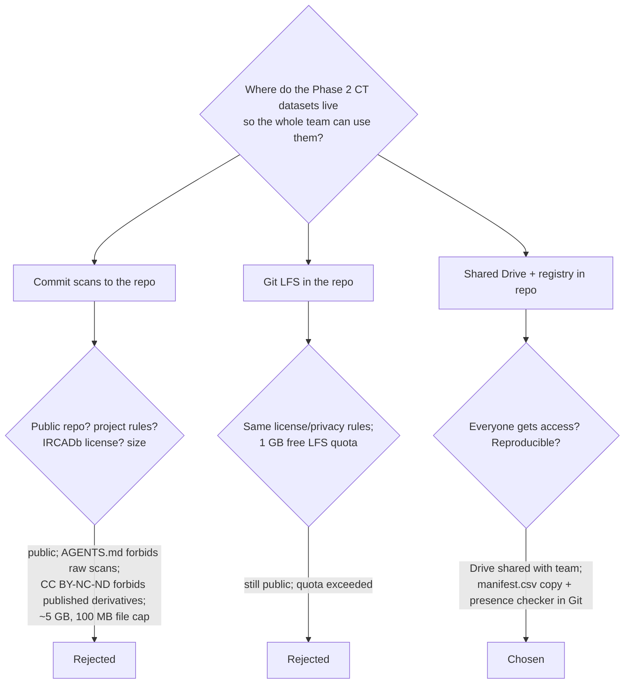
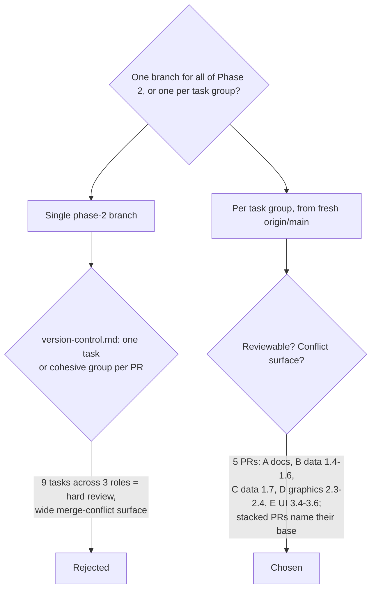
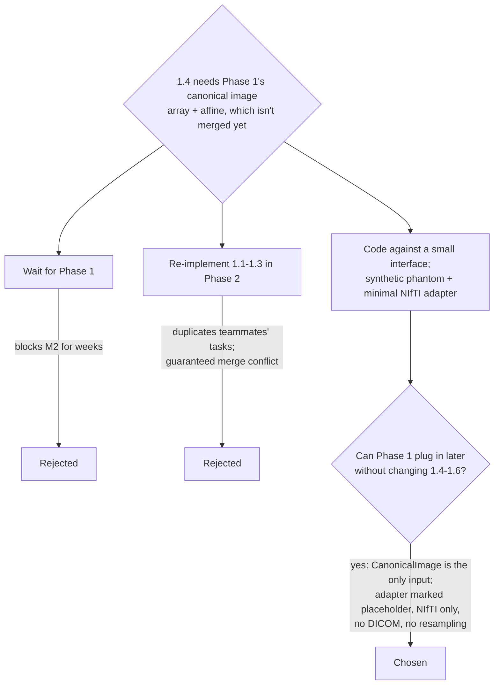
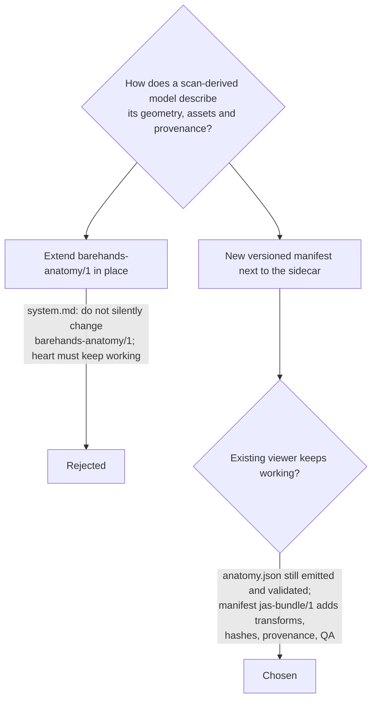
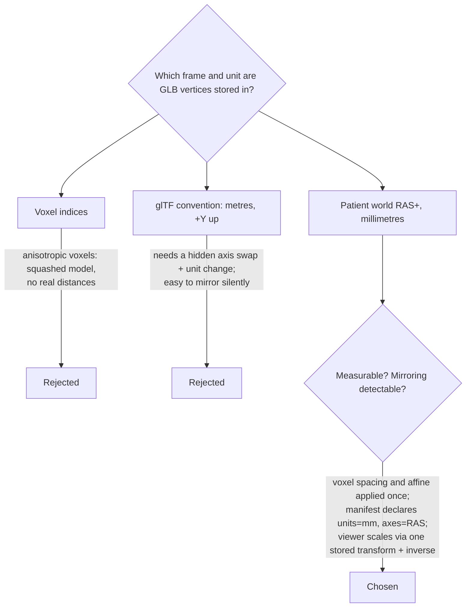
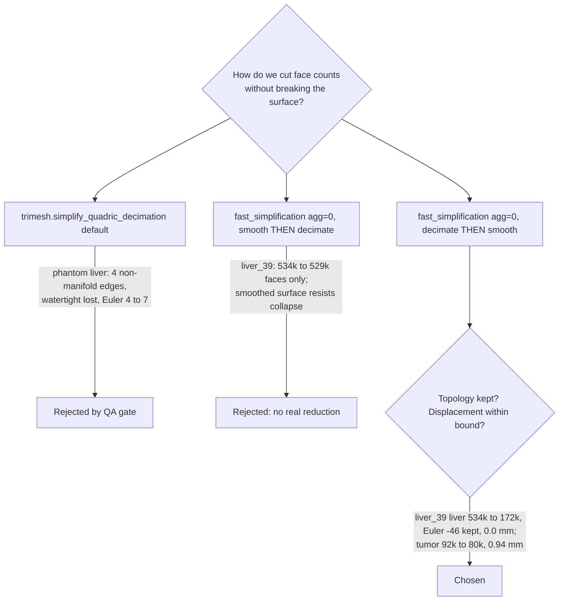
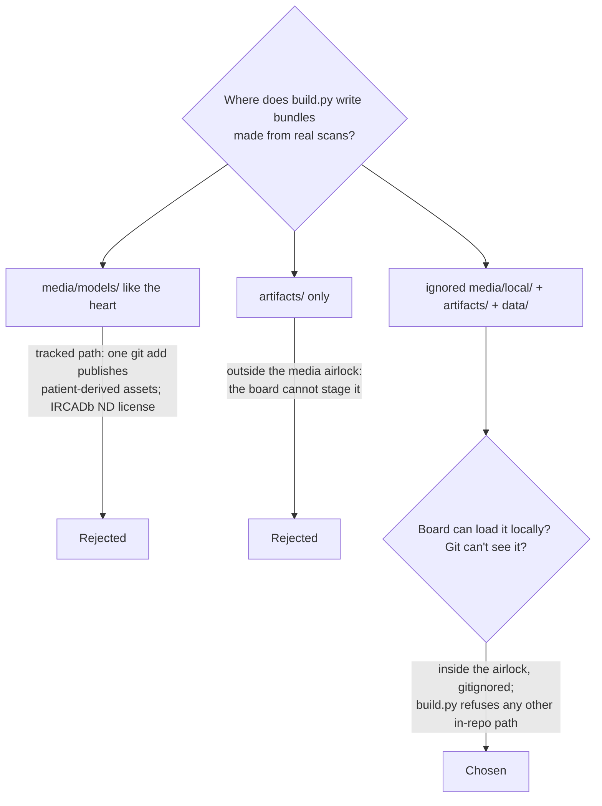
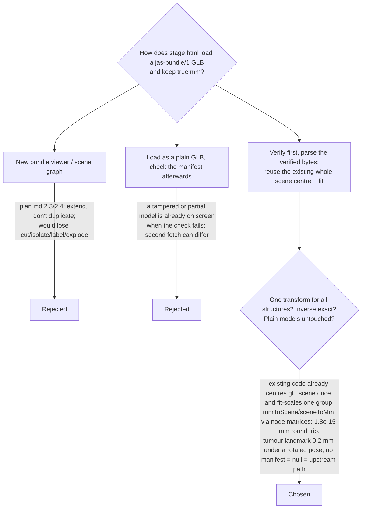

# Phase 2 decision log (decision trees)

Each Phase 2 (M2) choice is logged as a small decision tree. A tree shows the
question, the options considered, the criterion that ruled each option in or
out, and the leaf that was chosen. **Why trees:** if branches conflict at merge
time, the tree shows what each side meant to do, so the resolver can keep the
intent and not just one side's lines. Consequential, long-lived choices also
get an ADR (`NNNN-title.md`); this log links to it.

Entry format: ID · date · tasks · status (`proposed` until the owners'
review accepts it) · tree · evidence. Don't rewrite old entries. Add a new
entry that supersedes the old one and link the two.

---

## D-P2-01 Where the datasets live

2026-11-04 · tasks G1, 1.4–1.6 · proposed

Result: `datasets/README.md`, `datasets/manifest.csv` (metadata only),
`pipeline/fetch_datasets.py`, data root set by `JAS_DATA_ROOT`. Evidence:
the checker reported 45/45 cases complete on 2026-11-04.

## D-P2-02 How Phase 2 work is split into PRs

2026-11-04 · tasks G8 · proposed

## D-P2-03 Building on Phase 1 before it lands

2026-11-04 · tasks 1.2, 1.3, 1.4 · proposed

## D-P2-04 Asset bundle contract

2026-11-04 · tasks 1.6, 2.3, 2.4 · proposed · ADR
[0002](0002-bundle-manifest-and-patient-space.md)

## D-P2-05 Coordinate frame and units of exported meshes

2026-11-04 · tasks 1.4, 1.6, 2.4, G2 · proposed · ADR
[0002](0002-bundle-manifest-and-patient-space.md)

Consequence: `anatomy.json` `axes` for exported bundles is
`{superior:+z, left:-x, anterior:+y}` (RAS+: +x is patient right).

## D-P2-06 Decimation algorithm, aggression and step order

2026-11-04 · tasks 1.5, G2 · proposed

Open (needs G2): liver_39's liver stays above the 80k budget, because going
lower means removing small handles caused by voxel noise, and that is a
topology change. Taubin smoothing on the decimated liver exceeded the 1 mm
placeholder bound, so the liver ships unsmoothed. Whether a topology change
or more displacement is acceptable is an imaging-reviewer call, not a
performance call.

## D-P2-07 Where real-scan bundles are written

2026-11-04 · tasks 1.6, 1.7, G1 · proposed

Only `media/models/phantom/` (synthetic) is committed.

## D-P2-09 How the board loads a scan bundle

2026-11-04 · tasks 2.3, 2.4 · proposed · ADR [0002](0002-bundle-manifest-and-patient-space.md)

Consequences:
- The stage.html change is limited to two marked hooks: the parse source and
  the bbox cache key, which now includes the manifest revision.
- The bundle code lives in `js/medical/bundle.js`.
- core.js's `onModelLoaded` attaches the transform.

## D-P2-08 and D-P2-10 (separate files)

These two were written on branches that didn't include this log, so they
live as standalone files to avoid append conflicts:
[D-P2-08 serving scan bundles](phase2/D-P2-08-asset-serving.md) ·
[D-P2-10 how 3.4–3.6 "Verify" is done](phase2/D-P2-10-gesture-verification.md).
