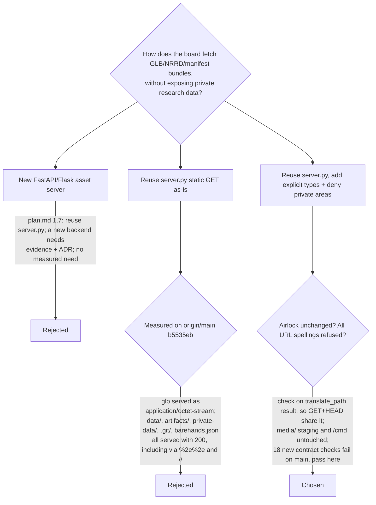

# D-P2-08 Serving scan bundles from the localhost server

2026-11-04 · tasks 1.7, G1, G4 · proposed

This entry lives in its own file because this PR is not stacked on the PR that
adds [`phase2-decision-log.md`](../phase2-decision-log.md) (#3). Two branches
appending to the same log would conflict at merge, and a separate file keeps
the intent intact either way. Once #3 merges, the log can link here.

Not added: `.nrrd` in the `/props` browser list. `/props` lists things the
board can *stage*, and the board cannot stage a volume until 2.5 (Phase 3).
Listing it would offer a prop that fails to open.

Still open for G4: this is a development server bound to 127.0.0.1. It is not an
authenticated delivery boundary for patient data.
