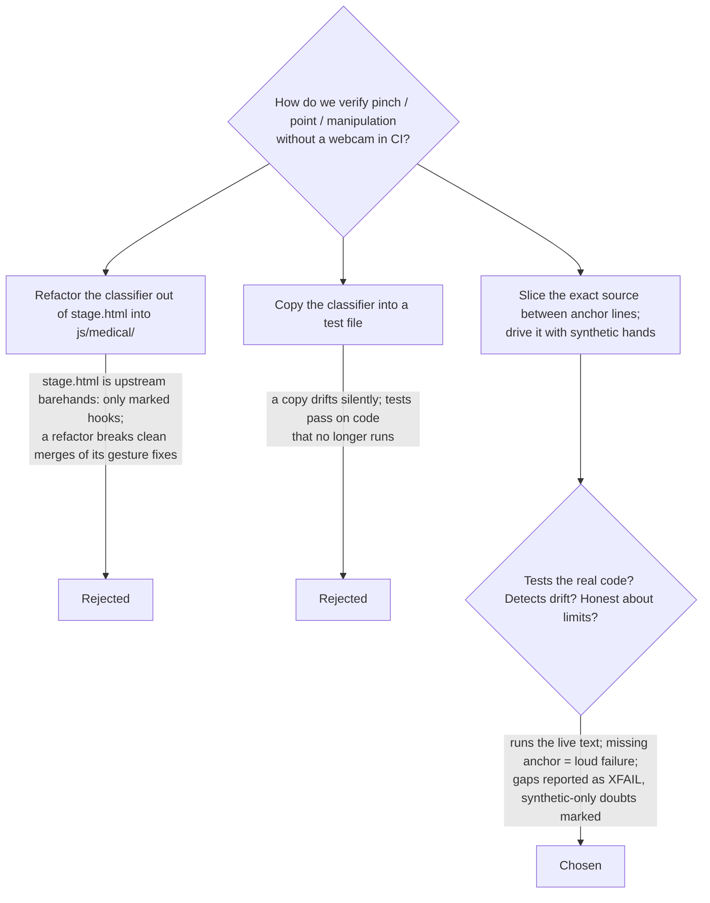

# D-P2-10 How 3.4–3.6 "Verify" is done

2026-11-04 · tasks 3.4, 3.5, 3.6, G3 · proposed

This entry is its own file because this PR is based on `main`, not on #3's
decision log, and a separate file can't produce an append conflict.

Known limits:
- Synthetic hands are 2-D in-plane poses. They can't stand in for depth,
  blur or the real corpus the thresholds were fitted on.
- A webcam session on the target hardware is still required, and it is
  reported as manual.
- Fixing the XFAIL gaps would change behaviour, so each fix needs its own
  task/PR and owner sign-off (UI / G3). This PR only records them.
