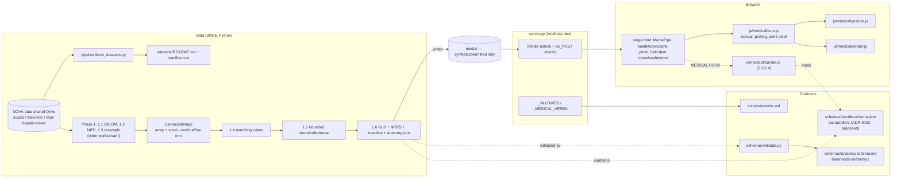

# Phase 2 knowledge graph: repo state, data, environment, rules

Snapshot: 2026-11-04, `origin/main` at `b5535eb`. Built for contributors and
agents working Phase 2 / M2 (tasks 1.4–1.7, 2.3–2.4, 3.4–3.6). **Load this
first, then verify live state** (`git status`, `git log`): line numbers drift,
and this file is a map, not evidence. Phase 1 and Phase 3 belong to other
workstreams; Phase 2 PRs do not touch their tasks.

## 1. Graph

## 2. Code nodes (Phase 2 touchpoints)

| Node | Location | Facts that matter for Phase 2 |
| --- | --- | --- |
| `loadThree` | `stage.html` ~818 | Dynamic imports of three, `GLTFLoader`, `RoomEnvironment` (CDN). |
| `buildModelScene(el, src, mm, lift)` | `stage.html` 827 | Loads GLB (`loadAsync` ~843); skeleton/animation-aware Box3 (~854–916); **bbox cache** in `localStorage["barehands-box:"+src]` (~860–910) — a regenerated file at the same path reads a stale box; centers `obj.position.sub(center)` (~918); explode rig (~929); fit-scale `1.3/bsz.length()` (~952). Called at ~1092 and ~3021 (render role). |
| Pinch classifier | `stage.html` 2071–2217 | Inline, OK-sign signature, hysteresis, `cur.pinched` (~2198), bad-run kill (~2214). Not node-testable today. |
| Held-item manipulation | `stage.html` 2631–2710 | Two-hand stretch scale (clamp 0.12–12), twist roll, midpoint move; rotate `ROT=0.012`, `rx/ry` clamped ±1.2, release momentum; hold-still promotes move→rotate. Idle spin ~2003. |
| `cursorFrame` / `pick` / `castAt` | `js/medical/core.js` 708 / 746 / 777 | Point = open hand + dwell `HOLD_MS`; raycast honors cut plane. |
| `onModelLoaded`, `sidecarURLs`, `buildIndex` | `core.js` 332 / 141 / 178 | Sidecar `<dir>/anatomy.json`, requires `schema: barehands-anatomy/1`; GLB mesh names matched to `structures[].meshes` globs. |
| Server airlock | `server.py` `do_POST` 276 (294–314) | `src` must resolve under `media/`; ambiguous bare basenames 400. |
| Static `/media` GET | `server.py` (SimpleHTTPRequestHandler) | No explicit `.glb` / `.nrrd` MIME map; `/props` `EXTS` (~375) lacks `.nrrd`. |
| Validator | `schemas/validate.py` | `validate.py anatomy.json [x.glb]`: shape + GLB mesh coverage (orphans, zero-match globs). |
| Heart fixture | `media/models/heart/` | BodyParts3D atlas, CC-BY-4.0, 16 structures, `axes {superior:+z, left:+x, anterior:-y}`. Atlas, **not** a scan. |
| Tests | `tests/` | `test_contract.py` (live server, 77 checks), `test_gesture.mjs` (copies `js/medical/*` to ignored `tests/cutgest/`), `test_visual.py` (headless Chrome renders). Run contract then visual against an idle server. |

`stage.html` MEDICAL HOOK regions (approx.): 288, 295, 1066, 1095, 1131, 1176,
1596, 1640, 2005, 2219, 2744, 2884, 2913, 3068. Additions go only inside new
marked hooks; every `MED` call optional (`MED.fn?.()`).

**Already built (extend, don't rewrite):** GLB loading/centering/scaling (2.3/2.4
baseline), pinch (3.4), point (3.5), rotate/scale/move (3.6). **Not built:**
volume→mesh pipeline (1.4–1.6), bundle manifest, scale-preserving transform
with inverse to mm, `.nrrd` serving. *(Update: 1.4–1.6 in `pipeline/` (PR B),
the bundle gate and mm transform in `js/medical/bundle.js` (PR D).)*

## 3. Data nodes

| Node | State (2026-11-04) |
| --- | --- |
| NOVA-data Drive | Present and complete: 45/45 cases verified by `pipeline/fetch_datasets.py` (20 IRCADb DICOM, 10 MSD liver, 15 MSD hepatic vessel). |
| Repo / GitHub branches | No scan data on any branch (by design). |
| Phase 2 working set | `liver_39` (1 mm iso), `hepaticvessel_424`, `3Dircadb1.13`, `3Dircadb1.8`; negative case `liver_91`. |
| Licenses | IRCADb CC BY-NC-ND (no published derivatives); MSD CC BY-SA. See [datasets/README.md](../../datasets/README.md). |
| Edge to Phase 1 | 1.4 consumes Phase 1's canonical image (array + affine). Until 1.2 lands, Phase 2 uses a minimal marked placeholder adapter, not a competing loader. |

## 4. Environment prerequisites (generic)

- Python ≥3.10 with `pipeline/requirements.txt` in a virtualenv **outside** the repo.
- Node ≥18 (gesture tests), Chrome (board + visual suite), Pillow (visual suite).
- Shared Drive mounted (Drive for Desktop) and `JAS_DATA_ROOT` set.
- Disk: unpack one IRCADb patient at a time into ignored `data/` (~1 GB each).
- `barehands.json` is local and untracked (copy the `.example`).

## 5. Rules graph (who says it)

| Rule | Source |
| --- | --- |
| Verify Git root + `git status --short --branch` before changes; inspect live state, don't trust chat memory. | AGENTS.md, VC skill |
| Task branch from fresh `origin/main`, `git switch -c <b> --no-track origin/main`; prefixes `feat/data|graphics|ui/<task>-<slug>`, `docs/<slug>`; one task/cohesive group per PR; stacked PRs name their base. | version-control.md §2/§4 |
| Stage exact paths; `git diff --check`; never merge/auto-merge, force-push, rewrite `main`, push to `nova`. | version-control.md §5, AGENTS.md |
| PR body = template + handoff guide: outcome, review route, one row per changed file with head-SHA links, actual check results, integration/rollback; refresh after each push. | pr-handoff.md, `.github/pull_request_template.md` |
| Decisions: ADR `docs/decisions/NNNN-title.md` (status, date, tasks, context, options, decision, consequences, evidence, reviewers); Phase 2 also logs a decision tree per choice. | decisions/README.md, [phase2 decision log](../decisions/phase2-decision-log.md) |
| Evidence: `docs/validation/YYYY-MM-DD-<task>.md`; never relabel historical runs as new; webcam checks are manual. | validation/strategy.md |
| `media/` airlock never widens; `/cmd` grows only via validated verbs. | CLAUDE.md |
| `stage.html` changes only inside marked `MEDICAL HOOK`s; medical code in `js/medical/`. | CLAUDE.md, AGENTS.md |
| Education/research only; no clinical claims; no content invented at runtime. | CLAUDE.md, KNOWLEDGE.md |
| No raw scans, patient-derived assets, identifiers, credentials or generated outputs in Git. | AGENTS.md, version-control.md §3 |
| New framework/backend needs evidence + ADR. | AGENTS.md, system.md |

## 6. Phase 2 PR map

| PR | Branch | Tasks | Depends on |
| --- | --- | --- | --- |
| A | `docs/phase2-knowledge-graph` | this graph, decision log, ADR 0002, dataset registry | — |
| B | `feat/data/1-4-1-6-surface-bundle` | 1.4, 1.5, 1.6 | A (ADR 0002 schema) |
| C | `feat/data/1-7-asset-serving` | 1.7 | — |
| D | `feat/graphics/2-3-2-4-bundle-loader` | 2.3, 2.4 | B |
| E | `feat/ui/3-4-3-6-gesture-verification` | 3.4, 3.5, 3.6 | — |

Merging is done by the repository owner's review process, not by Phase 2 authors.
